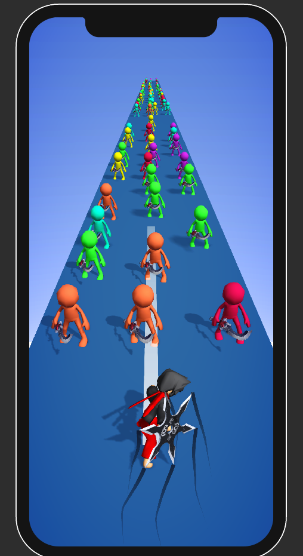
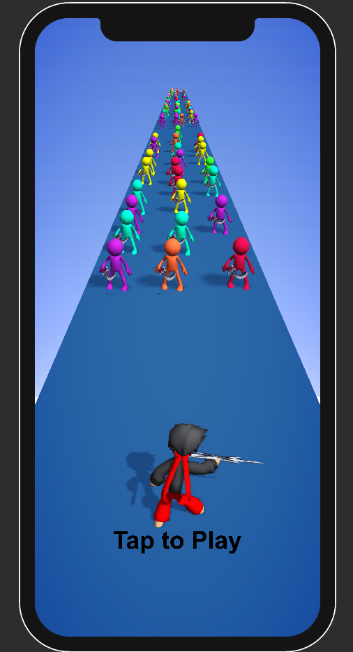
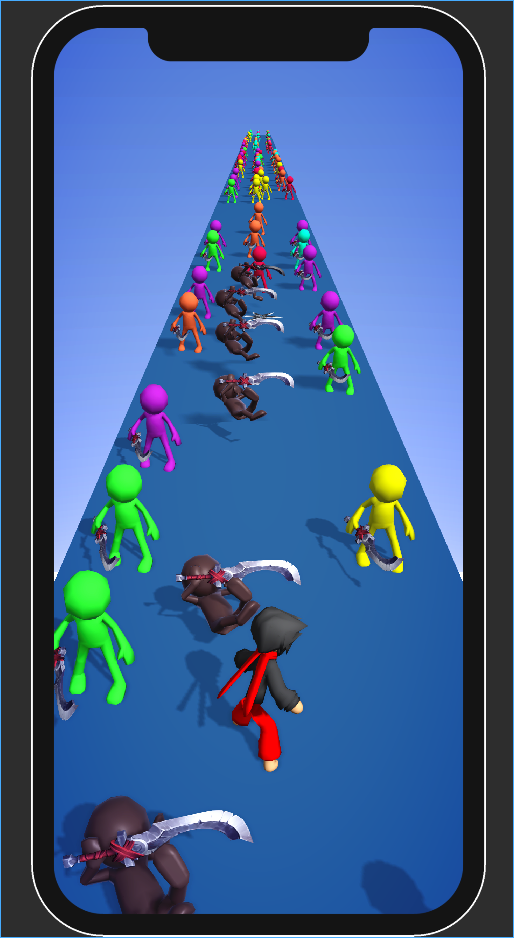
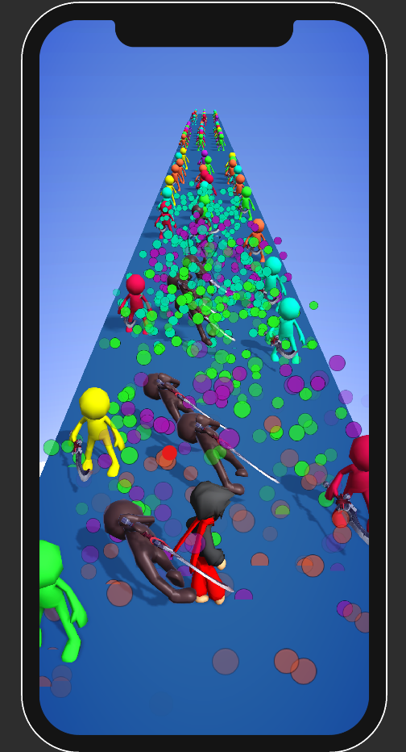
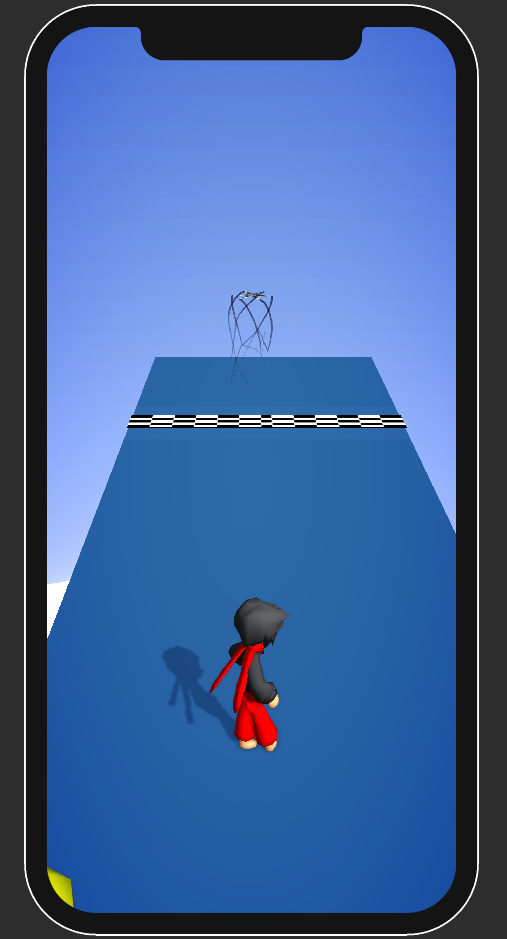
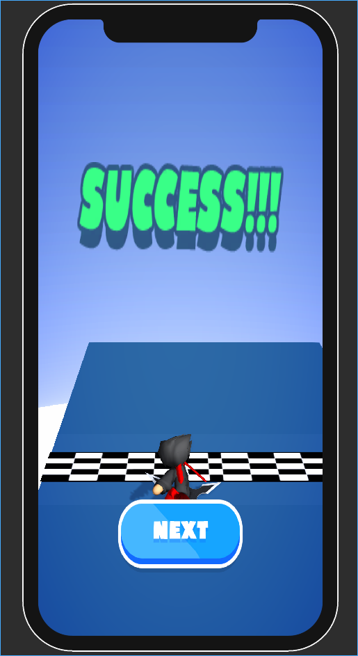
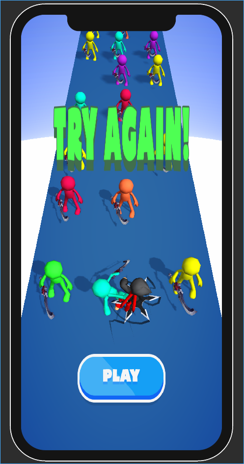

# NinjaNindo

Shuriken fırlatarak yoldaki düşmanları temizleyip bitiş çizgisine ulaşılan bir mobil koşu oyunu.

## Neden?

Basılı tut ve bırak kontrolüyle fırlatılan, sonra geri dönen bir shuriken mekaniğini mobil koşu oyununda denemek için yapıldı. Tek parmakla hem nişan alınıyor hem de silah geri çağrılıyor.

## Oynanış

- Karakter bitiş çizgisine doğru koşuyor; yolu açmak için düşmanları öldürmek gerekiyor.
- Parmak basılı tutuldukça fırlatma menzili uzuyor, bırakılınca shuriken fırlatılıyor.
- Tekrar basılı tutulursa shuriken geri çağrılıyor. Basılmazsa kısa bir süre bekleyip kendiliğinden dönüyor.
- Shuriken'in değdiği düşman rengini kaybedip anında ölüyor.
- Shuriken'in yolu karesel Bézier eğrisiyle hesaplanıyor; kavisli bir yörüngede dönerek gidip geliyor.

## Ekranlar

| Başlangıç | Shuriken fırlatma |
|---|---|
|  |  |
| **Ölen düşmanlar** | **Bitiş çizgisi** |
|  |  |
| **Kazanma** | **Kaybetme** |
|  |  |

## Teknik

| | |
|---|---|
| **Motor** | Unity 2022.1.7f1 |
| **Kullanılanlar** | DOTween, karesel Bézier eğrisi, görsel efektler, ScriptableObject ile düşman tipleri |
| **Kod** | `Assets/Codes` (karakter, düşman, yönetici scriptleri) |
| **GitHub'a yükleme** | Şubat 2023 |
